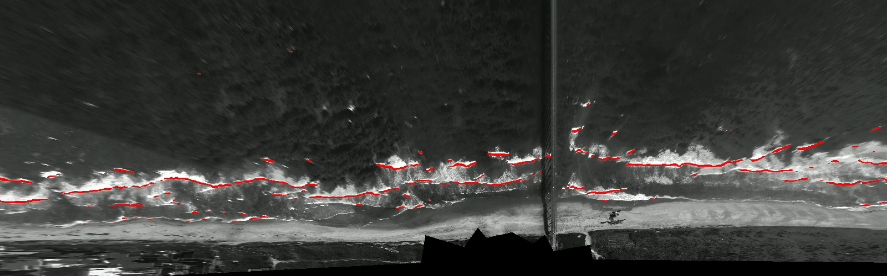

# Breaking-wave crest detection



Segment breaking-wave crests in rectified Argus video, extract crest speeds,
and merge them with FRF (Duck, NC) environmental data. Video dataset:
[Dryad](https://doi.org/10.5061/dryad.r2280gbsn).

## Setup

Requires Python 3.12 and [uv](https://docs.astral.sh/uv/).

```bash
uv sync --locked
```

Put the inputs here (or set `DUNEX_DATA_ROOT` / `DUNEX_OUTPUTS_DIR`):

| Asset | Location | Source |
|---|---|---|
| Checkpoint bundle | `model/outputs/released/segnext_t_learned_up_skip_4_2/` | GitHub release |
| Argus videos | `data/video_dataset/argus/` | [Dryad](dryad/README.md) `imagery/` |
| Argus header metadata | `data/argus/metadata/` | [Dryad](dryad/README.md) `metadata/` |
| Environmental data | `data/bathy/`, `data/water_level/`, `data/8m_array_waves/`, `data/met/` | `download.py` in each folder |
| Merged dataset | `data/dunex_breaking_wave_crest_dataset.nc` | GitHub release |
| Validity mask | `data/video_dataset/good_data_mask.nc` | Included in Git |
| Labeled images (training only) | `model/data/full_split/`, `model/data/ood_test/` | GitHub release |
| Encoder weights (training only) | `model/pretrained_weights/segnext_tiny_512x512_ade_160k.pth` | [download link](model/pretrained_weights/README.md) |

See [`data/README.md`](data/README.md) and
[`model/data/README.md`](model/data/README.md) for details.

## Pipeline

**1. Inference** — prediction AVI, overlay, and density image per video
(SegNeXt-T, threshold 0.48; device auto-selects CUDA → MPS → CPU). The
production crest masks are also published in Dryad's `crests/` folder:

```bash
uv run python model/segmentation/predict_video.py model/segmentation/configs/predict_argus.yaml
```

**2. Crest speeds** — speed NetCDF, pixel-speed map, and trajectory CSV per video:

```bash
uv run python model/calculate_wave_speeds.py model/predictions/argus model/predictions/wave_speeds --completed-only
```

**3. Manual QC** — on visual inspection of the speed maps, three Sep 17 videos
had isolated false-track patches. Remove 8-connected regions smaller than
2000 pixels; cleaned files are written to `wave_speeds/postprocessed/`:

```bash
uv run python figures/postprocess_wave_speed_maps.py \
  model/predictions/wave_speeds/ArgusFF_20210917T{143000,163000,173000}Z_RectifiedVideo_pred_speeds.nc \
  --min-component-pixels 2000
```

**4. Merge** with environmental data, substituting the cleaned files:

```bash
P=model/predictions/wave_speeds/postprocessed
uv run python create_merged_dataset.py \
  --speeds-dir model/predictions/wave_speeds \
  --speed-override $P/ArgusFF_20210917T143000Z_RectifiedVideo_pred_speeds.nc \
  --speed-override $P/ArgusFF_20210917T163000Z_RectifiedVideo_pred_speeds.nc \
  --speed-override $P/ArgusFF_20210917T173000Z_RectifiedVideo_pred_speeds.nc \
  --out data/dunex_breaking_wave_crest_dataset.nc
```

**Training (optional)** — retrain the production model, or rerun the full
model study with `model/ablation/run_all.sh`:

```bash
uv run python -m train --config ablation/configs/segnext_t_learned_up_skip_4_2.yaml --device cuda
```

## AI Disclaimer

The initial version of this work was written by hand. Claude was used to write
and refactor code and documentation for analysis, ML training, and figure
generation in this published version. The code and documentation have been
reviewed and edited by the authors.
